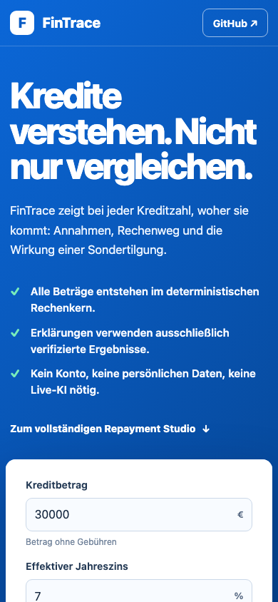

# FinTrace — Traceable Financial Intelligence

**Jede Zahl hat einen Ursprung.**

FinTrace ist ein unabhängiges Engineering-Portfolio-Projekt für transparente Kreditberechnungen. Das Produkt macht nicht nur Ergebnisse sichtbar, sondern auch deren Herkunft, Annahmen und Rechenweg.

> Kredite verstehen. Nicht nur vergleichen.

## Status

Phase 0 bis Phase 7 sind umgesetzt. FinTrace umfasst einen deterministischen Rechenkern, ein responsives Repayment Studio, Zinsszenarien, einen verifizierten Recorded Assistant, automatisierte Qualitäts- und Bereitstellungsprozesse, optionale REST-/MCP-/Retrieval-Adapter sowie ein vollständiges technisches Review-Paket.

Für einen schnellen technischen Einstieg:

1. [Engineering-Portfolio](docs/engineering-portfolio.md)
2. [5-Minuten-Demo](docs/demo-guide.md)
3. [Architekturentscheidungen](docs/decisions.md)
4. [Teststrategie](docs/test-strategy.md)

## Live-Demo

[FinTrace Repayment Studio öffnen](https://yongshicc.github.io/fintrace/)

### Mobile Experience

The same deterministic simulation workflow is available in a responsive mobile layout without horizontal overflow.

<p align="center">
  
</p>

## About Me

Vienna-based developer with an interdisciplinary background in Digital Humanities, frontend engineering and AI-driven product development.

I build interactive web applications, explore local AI systems and develop reliable, traceable software solutions.

## Achievements

🏆 **2nd Place — Track: Think Fast: Local Decision Models**<br>
Building Better Worlds Hackathon · proximata × START Vienna × HOIV<br>
November 2026 · Solo Participant · DecideFast

🏆 **2nd Place — Clinical AI Hackathon Vienna 2026**<br>
AIM Austria · October 2026

## Featured Projects

### FinTrace — Traceable Financial Intelligence

Interactive credit simulations, deterministic financial calculations and traceable AI explanations.

[Live Demo](https://yongshicc.github.io/fintrace/) | [Source Code](https://github.com/yongshicc/fintrace)

### DecideFast — Offline Decision Intelligence

Award-winning local AI decision-support system with automated workflows and human-in-the-loop review.

[Source Code](https://github.com/yongshicc/Decisionfast-Agent)

## Tech Stack

React · TypeScript · JavaScript · Python · REST APIs · n8n · LLM · GitHub Actions · Vitest · Playwright

## Development Philosophy

**AI-assisted development. Human understanding. Verifiable results.**

## Lokale Entwicklung

Voraussetzung: Node.js 22 und npm 10 oder kompatible neuere Versionen.

```bash
npm install
npm run dev
```

Qualitätsprüfung:

```bash
npm test
npm run test:e2e
npm run verify:references
npm run typecheck
npm run lint
npm run format:check
npm run build
```

Der erste lokale Browser-Test benötigt einmalig Chromium:

```bash
npx playwright install chromium
```

## CI und öffentliche Bereitstellung

`.github/workflows/ci.yml` führt für jeden Push und Pull Request Tests, Referenzprüfung, Typecheck, Linting, Formatprüfung, Build und Browser-Smoke-Tests aus. Nach einem erfolgreichen Quality-Lauf auf `main` erstellt `.github/workflows/deploy-pages.yml` eine statische GitHub-Pages-Ausgabe. Alternativ lässt sich die Bereitstellung manuell starten.

Im GitHub-Repository muss unter **Settings → Pages → Build and deployment** einmalig **GitHub Actions** als Quelle gewählt werden. Die Veröffentlichung verwendet ausschließlich GitHub-OIDC und benötigt keine bezahlten API-Zugangsdaten oder Client-Secrets.

## Architektur

Alle Finanzlogik liegt in `src/engine`. Die Funktionen sind rein, strikt typisiert und unabhängig von React. UI-Code darf keine Finanzformeln duplizieren. Intern wird mit voller JavaScript-`number`-Präzision gerechnet; Rundung erfolgt erst in der Darstellung.

Weitere Details:

- [Architektur](docs/architecture.md)
- [Engineering-Portfolio](docs/engineering-portfolio.md)
- [Architekturentscheidungen](docs/decisions.md)
- [Berechnungsmethode](docs/calculation-method.de.md)
- [Teststrategie](docs/test-strategy.md)
- [Demo-Guide](docs/demo-guide.md)
- [Produktkonzept](docs/product-concept.de.md)
- [Roadmap](docs/roadmap.md)
- [Optionale Integrationen](docs/integrations.md)
- [KI-Entwicklungslog](docs/ai-development-log.md)

## KI-Prinzip

**KI erklärt. Der Rechner rechnet.** Finanzielle Zahlen entstehen ausschließlich im deterministischen Rechenkern, niemals in einem Sprachmodell.

Der aktuelle Assistent ist eine öffentliche Recorded Demo: Er verwendet vorab geprüfte Erklärungstexte und zeigt ausschließlich Werte aus typisierten Engine-Ergebnissen. Es findet kein Live-Aufruf eines Sprachmodells statt.

## Disclaimer

FinTrace ist ein unabhängiges Portfolio-Projekt zur Simulation von Kreditkosten. Keine Kreditberatung und kein Kreditangebot. Es besteht keine Verbindung zu CHECK24.

## Lizenz

[MIT](LICENSE)
